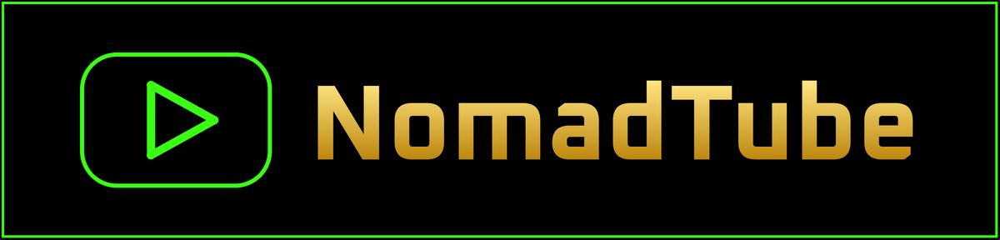

# NomadTube



A portable Windows front-end for [yt-dlp](https://github.com/yt-dlp/yt-dlp): paste a link, pick a
quality (or MP3), download. Channels, playlists, queue, history, auto-update — no installer.

**[Download NomadTube.exe](https://github.com/jlewsi/nomadtube/releases/latest)** - single file, no installer.

---

## ⚠️ Cookies are required

YouTube blocks most downloads from "signed-out" clients, so **you must supply a `cookies.txt`**
or downloads fail with *"Sign in to confirm you're not a bot"*.

1. Install the browser extension **Get cookies.txt LOCALLY**
   ([Chrome](https://chromewebstore.google.com/detail/get-cookiestxt-locally/cclelndahbckbenkjhflpdbgdldlbecc) ·
   [Firefox](https://addons.mozilla.org/firefox/addon/get-cookiestxt-locally/)).
2. Open a **private/incognito** window and sign in to **youtube.com** there.
3. With that page open, click the extension and **Export** — save the file as **`cookies.txt`**.
4. Put `cookies.txt` **in the same folder as `NomadTube.exe`**.

Re-export the file whenever the cookies expire. Using a private window keeps your main browser
session separate, and you can log out of that session afterwards.

## Install (portable)

1. Download the latest `NomadTube.exe` from the [latest release](https://github.com/jlewsi/nomadtube/releases/latest).
2. Get [`yt-dlp.exe`](https://github.com/yt-dlp/yt-dlp/releases/latest) and
   [`ffmpeg.exe`](https://www.gyan.dev/ffmpeg/builds/).
3. Put them in one folder, add your `cookies.txt`, run `NomadTube.exe`.

Nothing is installed, no registry keys, no `%AppData%` — settings and history are JSON files in the
same folder, so the whole folder is the app. Deleting the folder removes every trace.

> Upgrading from **MPC Grabber**? Drop `NomadTube.exe` into the same folder and run it: settings,
> history and saved channels are imported automatically from the old `mpcgrabber.*.json` files.

## Features

- **Channel links work on the Download page too** — paste a channel URL or `@handle` and *Fetch*
  switches to the Channels tab and loads that channel with the timeframe you last picked.
- **Real formats per URL** — after *Fetch* it shows the actual resolutions with approximate sizes,
  plus **Best** and **MP3 320 / 192 / 128**.
- **Playlists** — checkbox list with All/None; your chosen quality applies to every checked item.
- **Queue page** — its own section in the sidebar. Starting a playlist download jumps straight to it,
  with every item's state, quality, live percent / speed / ETA, *Cancel current* and *Clear finished*.
  It auto-scrolls to keep the file currently downloading in view.
- **Defaults** — set a default video quality and a default MP3 bitrate; the matching format is
  preselected every time you fetch a link.
- **Auto-update** — optionally checks GitHub on launch and, when a newer release exists, downloads it,
  swaps the exe and restarts. Toggle it in Settings, where a **Check now** button and the current
  version are shown too.
- **Loading spinner** — a large spinning ring replaces the content while yt-dlp reads a link or channel.
- **Channels** — load any channel by URL or `@handle`, filter to the last 24 hours / 7 days / 30 days, and pick
  from its uploads. Videos come first, then Shorts (badged `SHORT`). Channels are saved on the left with a
  per-channel download count, and anything already downloaded is marked and starts unchecked.
- **History** — open file, reveal in Explorer, re-download, delete, clear. Files on disk are never
  deleted by clearing history.
- **Settings** — download folder (default `Downloads` next to the exe), default video quality,
  default MP3 bitrate, cookies status, updates, yt-dlp/ffmpeg detection.
- **Terminal look** — black background, green accents and gold highlights; green button outlines, gold
  outlines for selected controls, and a green window frame while the window is floating.
- Drag-and-drop URLs, dark title bar, single ~130 KB executable.

## Channels

Paste a channel URL (`https://www.youtube.com/@handle`, `/channel/UC…`, `/c/name`) or just `@handle`, pick a
timeframe — **Last 24 hr**, **7 days** or **30 days** — and press **Fetch**.

- Uploads are listed newest first; **Shorts are listed separately underneath**, badged `SHORT` with a
  gold border (video rows are blue).
- Live streams, premieres and upcoming streams are skipped.
- YouTube's Shorts tab exposes no publish dates, so the newest **12 shorts** are always listed and shown as
  `recent`. Video dates are approximate to the day (that is what the channel listing provides).
- **Paste** fills the box from the clipboard; the three time buttons only pick the default timeframe —
  they never reload on their own. That default is remembered and is also what a channel link pasted on
  the Download page uses.
- Save a channel by loading it — it stays in **Saved channels** with how many files you have downloaded from it.
  Items already downloaded are dimmed, ticked with a green check and left unchecked.
- Channel downloads are named **`Channel - Title - MMDDYY-HHMM.ext`** (the time part is dropped when YouTube
  does not expose one) and are recorded in History with the channel name.
- CLI: `NomadTube.exe --channel "@handle"` opens straight to that channel. Downloads use your default video
  quality from Settings.

## Keyboard

| Keys | Action |
|---|---|
| `Enter` in the URL box | Fetch |
| `Ctrl+Enter` | Download |
| `Ctrl+L` | Focus the URL box |
| `Esc` | Cancel the running download |

## Command line

```
NomadTube.exe "https://youtu.be/…"              # open with a link filled in
NomadTube.exe "https://youtu.be/…" --download   # fetch and start immediately
NomadTube.exe "@handle"                          # open a channel directly
```

Handy for desktop shortcuts.

## Build from source

No SDK, no Visual Studio, no NuGet — it compiles with the C# compiler that ships with Windows
(.NET Framework 4.8):

```powershell
.\make-assets.ps1   # rebuilds app.ico + assets\banner.png from the source art (optional)
.\build.ps1         # -> bin\NomadTube.exe
```

`build.ps1` calls `C:\Windows\Microsoft.NET\Framework64\v4.0.30319\csc.exe` on every `.cs` file in
`src\`, embeds the banner and applies the icon.

## Notes

- History/settings: `nomadtube.history.json`, `nomadtube.settings.json`, `nomadtube.channels.json`.
- Failures are logged to `nomadtube.log` beside the exe (only written when something goes wrong).
- The app is DPI-unaware on purpose so it scales correctly on mixed-DPI multi-monitor setups;
  Windows bitmap-scales it on displays above 100%.
- This is a front-end only: all downloading is done by yt-dlp. Respect the terms of service of the
  sites you download from and only download content you have the rights to.
